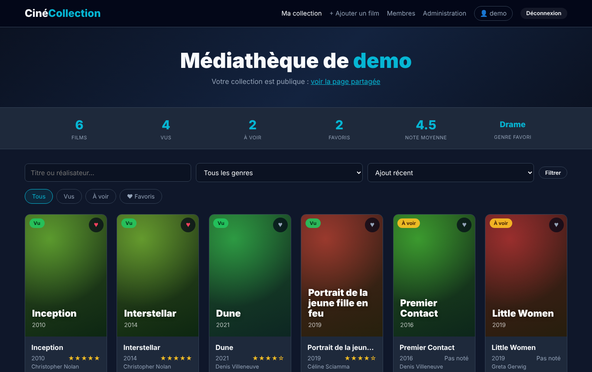
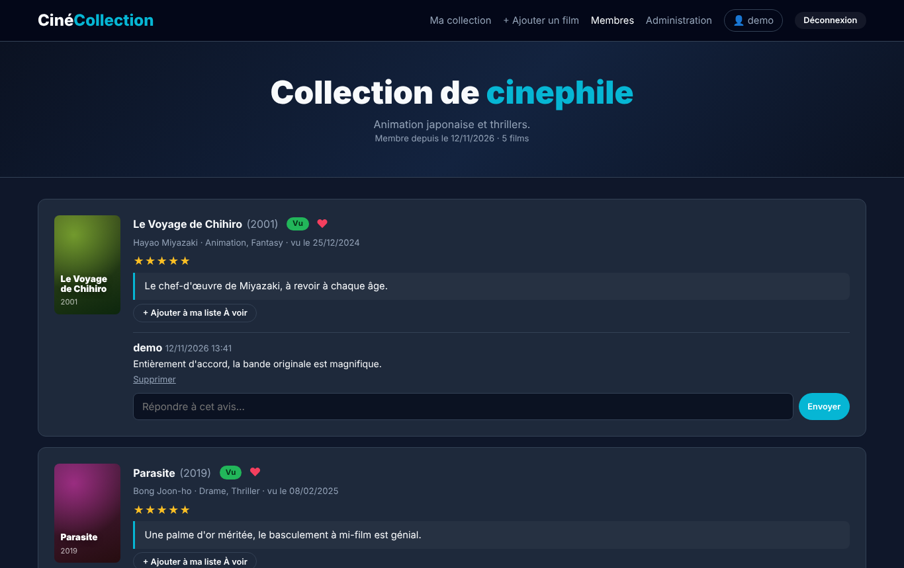
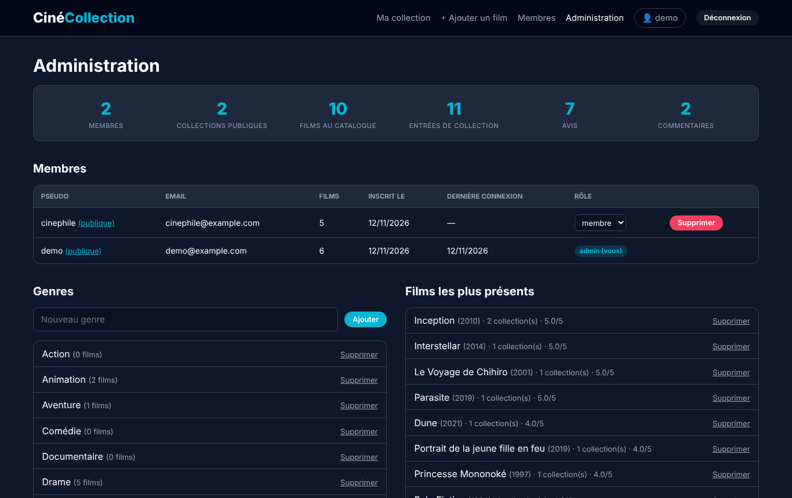

# CinéCollection

Application web de gestion de collection de films en PHP et MySQL. Chaque membre gère sa médiathèque (films vus, à voir, favoris), note et critique ses films, et peut partager sa collection avec les autres membres.

Projet universitaire, UE Programmation Web, L2 MIASHS, Université Paris Nanterre, 2026.
Version d'origine réalisée en binôme avec Abdelkader Cherfaoui, puis reprise et enrichie (v2).

## Aperçu

| Collection publique et avis | Administration |
| --- | --- |
|  |  |

## Fonctionnalités

Comptes et sécurité
- Inscription avec pseudo, email et mot de passe (8 caractères minimum, lettre et chiffre), indicateur de force du mot de passe
- Connexion avec le pseudo ou l'email, option « Se souvenir de moi » (30 jours)
- Page profil : modifier pseudo, email et bio, changer de mot de passe, déconnecter ses appareils, supprimer son compte
- Rôle administrateur : le premier compte créé est admin
- Mots de passe hachés (`password_hash`), requêtes préparées (PDO), protection CSRF sur tous les formulaires, échappement des sorties contre le XSS, limite de 5 essais de connexion

Collection
- Catalogue de films partagé entre les membres, avec réalisateurs et genres multiples
- Statut vu / à voir, favoris, note de 1 à 5, avis écrit et date de visionnage
- Recherche par titre ou réalisateur, filtres par genre et par statut, tri
- Statistiques : nombre de films, vus, à voir, favoris, note moyenne, genre favori

Partage
- Collection publique ou privée, au choix de chaque membre
- Page « Membres » avec les collections publiques et les derniers avis
- Commentaires sous les avis des autres membres
- Ajout en un clic d'un film vu chez un autre membre dans sa liste « À voir »

Administration
- Statistiques globales du site
- Gestion des membres (rôle, suppression), des genres et du catalogue

## Base de données

8 tables reliées par des clés étrangères :

| Table | Rôle |
| --- | --- |
| `users` | Comptes, rôle (`user` / `admin`), collection publique ou non |
| `remember_tokens` | Jetons « Se souvenir de moi » (seul le hash du secret est stocké) |
| `films` | Catalogue partagé (titre, année, affiche, synopsis) |
| `realisateurs` | Réalisateurs, liés aux films |
| `genres` et `film_genres` | Genres, avec une relation plusieurs-à-plusieurs vers les films |
| `collection` | Lien membre ↔ film : statut, favori, note, avis, date de visionnage |
| `commentaires` | Réponses des membres sous un avis |

## Technologies

PHP 8, MySQL / MariaDB, PDO, HTML5, CSS3 (Grid, variables), JavaScript.

## Lancer le projet

1. Installer [XAMPP](https://www.apachefriends.org/fr/index.html) et démarrer Apache et MySQL.
2. Copier le dossier du projet dans `C:\xampp\htdocs\cinecollection`.
3. Dans phpMyAdmin (http://localhost/phpmyadmin), onglet Importer : importer `database.sql`.
   Facultatif : importer ensuite `demo.sql` pour avoir des données d'exemple (comptes `demo` et `cinephile`, mot de passe `Demo1234`).
4. Copier `config.example.php` en `config.php` et y mettre vos identifiants MySQL (par défaut sous XAMPP : `root` sans mot de passe).
5. Ouvrir http://localhost/cinecollection et créer un compte : le premier compte est administrateur.

## Historique

- Premier commit : version rendue en L2 (connexion simple, une table de films par utilisateur).
- v2 : nouvelle base de données relationnelle, comptes avec email et rôles, profil, administration, listes, avis, commentaires et collections publiques.

Le rapport et la présentation (mis à jour pour la v2) sont dans le dossier `docs`. Leurs versions d'origine restent consultables dans le premier commit.
